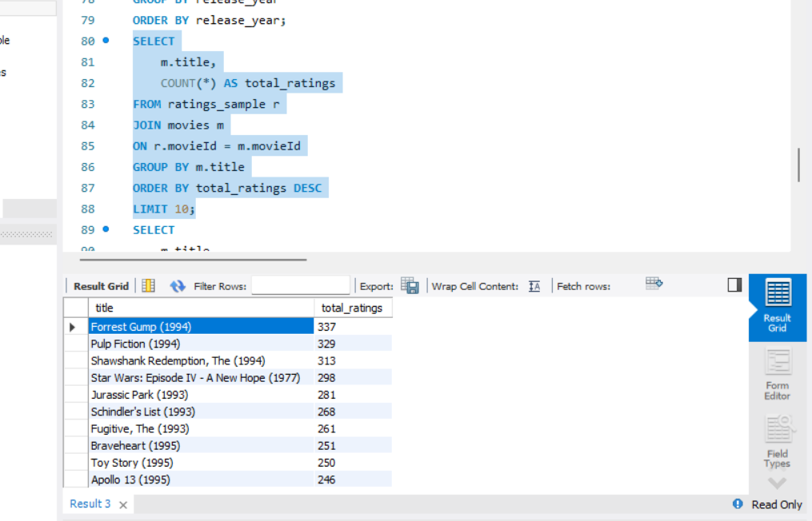
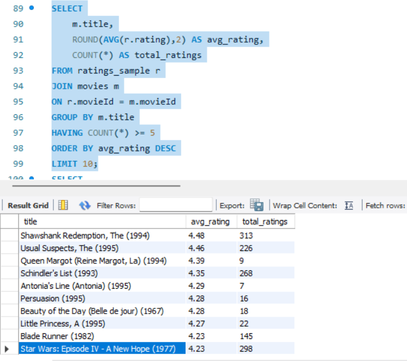
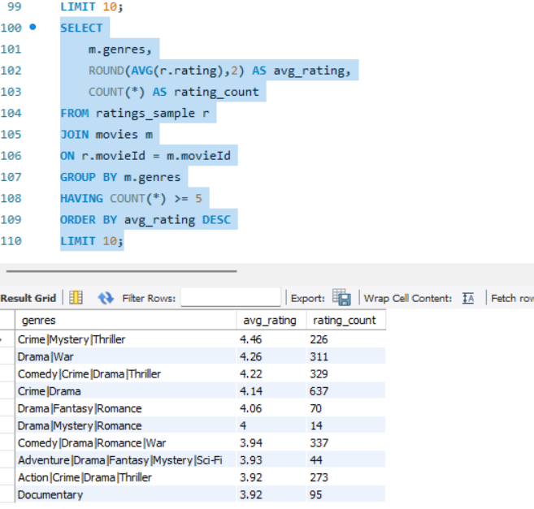

# MovieLens SQL Analysis

**Live dashboard:** [ananya3283.github.io/MovieLens-SQL-Analysis](https://ananya3283.github.io/MovieLens-SQL-Analysis/), an interactive version of these queries. Filter by genre and release decade and choose the minimum number of ratings for "top rated"; every figure is computed from `movies.csv` and `ratings_sample.csv` (`web/scripts/build_data.py`).
## Overview
I worked on this project to strengthen my SQL skills by analyzing the MovieLens dataset.
The dataset contains information about movies and user ratings. Using SQL queries, I explored rating patterns, identified popular movies, and analyzed genre performance. The project helped me practice joins, aggregations, filtering, and sorting while extracting meaningful insights from relational data.

## Tools Used
- SQL
- MySQL Workbench

## Dataset
MovieLens Sample Dataset
Main tables used:
- movies
- ratings_sample

## Analysis Performed

### 1. Most Frequently Rated Movies
Identified movies that received the highest number of ratings from users.

### 2. Highest Rated Movies
Calculated average ratings and filtered movies with at least 5 ratings to identify highly rated films.

### 3. Genre Analysis
Analyzed genres based on average ratings and total rating counts.

## Query Results
### Top 10 Most Frequently Rated Movies

### Top 10 Highest Rated Movies

### Top Genres by Average Rating

## Key Findings
- *Forrest Gump (1994)* received the highest number of ratings in the dataset.
- *The Shawshank Redemption (1994)* achieved one of the highest average ratings among movies with significant user engagement.
- Crime, Mystery, and Thriller combinations received some of the strongest average ratings.
- Rating counts and average ratings do not always tell the same story; some movies are highly popular, while others receive fewer but stronger ratings.

## SQL Concepts Used
- SELECT
- WHERE
- GROUP BY
- ORDER BY
- HAVING
- COUNT()
- AVG()
- ROUND()
- INNER JOIN
- LIMIT

## Files Included
- MovieLens_SQL_Queries.sql
- Dataset
- Query Result Screenshots
- README.md

## Skills Practiced
- SQL Querying
- Joins and Aggregations
- Data Analysis
- Relational Databases
- Data Exploration
- Business Insights

## Conclusion
This project helped me gain hands-on experience with SQL by working on a real-world movie ratings dataset. Through query writing and analysis, I learned how to extract insights from structured data and answer practical business questions.

## Web version
`web/` is a React + TypeScript + Vite app (Tailwind, Recharts, Motion), deployed to GitHub Pages by `.github/workflows/pages.yml`. Rebuild the data with `python web/scripts/build_data.py`, then `cd web && npm install && npm run dev`. "Top rated" defaults to movies with at least 20 ratings, so a movie with a handful of 5-star ratings doesn't top the list.
